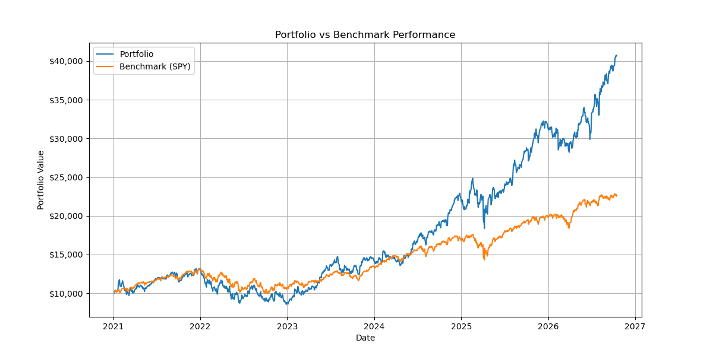
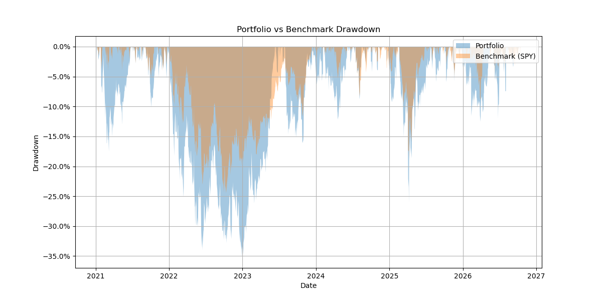

# Portfolio Backtester

A general-purpose portfolio backtesting tool in Python. Give it any set of tickers and weights, and it pulls historical prices from Yahoo Finance, builds a weighted portfolio, and compares it to a benchmark (SPY by default) on return and risk metrics, with charts.

## What it does

- Fetches dividend-adjusted daily prices for any tickers via `yfinance`
- Combines tickers into a single weighted portfolio
- Calculates four performance metrics for both the portfolio and the benchmark:
  - **CAGR** (compound annual growth rate)
  - **Annualized volatility**
  - **Sharpe ratio**, using the average 10-year Treasury yield (`^TNX`) over the backtest period as the risk-free rate
  - **Maximum drawdown**
- Plots growth of $10,000 (portfolio vs. benchmark) and drawdown over time
- Returns everything in a single `BacktestResult` dataclass

## Example

```python
from backtest import backtest

result = backtest(
    tickers=["AAPL", "EXPD", "PLTR"],
    weights=[0.5, 0.3, 0.2],
    start_date="2021-01-01",
    end_date="2026-10-16",
    benchmark_ticker="SPY",   # optional, defaults to SPY
    plot=True,                # optional, set False to skip the charts
)

print(result.portfolio_sharpe_ratio)
```

Sample output for the portfolio above (2021-01-01 to 2026-10-16):

| Metric | Portfolio | SPY |
|---|---|---|
| CAGR | 27.2% | 15.0% |
| Annualized volatility | 26.3% | 16.6% |
| Sharpe ratio | 0.90 | 0.69 |
| Max drawdown | 35.2% | 24.5% |

Over this period the portfolio beat SPY on both return and Sharpe ratio, but with higher volatility and a deeper maximum drawdown. A $10,000 investment grew to about $40,700 in the portfolio versus about $22,600 in SPY. Results can shift slightly over time because Yahoo Finance occasionally revises historical data.

### Charts




## Setup

Requires Python 3.10 or newer.

```bash
pip install -r requirements.txt
python backtest.py
```

## Project structure

| File | Responsibility |
|---|---|
| `data.py` | Fetching: adjusted close prices and the average risk-free rate |
| `metrics.py` | Calculations: daily returns, CAGR, volatility, Sharpe ratio, drawdown |
| `portfolio.py` | Weighted portfolio returns and cumulative portfolio value |
| `results.py` | The `BacktestResult` dataclass |
| `visualize.py` | Growth and drawdown charts |
| `backtest.py` | Orchestrates the pipeline and returns a `BacktestResult` |

The metric functions are independent of any particular portfolio, so the same code runs on the portfolio and the benchmark. The benchmark goes through the same pipeline as the portfolio (a single asset with weight 1.0), so the comparison covers identical dates.

## Design notes and assumptions

- **Fixed weights are applied every day**, which is equivalent to daily rebalancing, not buy-and-hold. Weights don't drift as prices move.
- **The date range is limited by the newest ticker.** Rows where any ticker has no price are dropped, so the backtest starts on the first day all tickers have data.
- **Risk-free rate:** a single average of the 10-year Treasury yield over the backtest period, not a daily series.
- **Volatility** is the standard deviation of daily returns, annualized by √252.
- **Sharpe ratio** is (CAGR − risk-free rate) / annualized volatility.
- **Input validation:** the number of weights must match the number of tickers, and weights must sum to 1.0, otherwise a `ValueError` is raised. Invalid tickers and empty date ranges also raise clear errors.

## Limitations

- No configurable rebalancing schedule (daily rebalancing only)
- Data comes from Yahoo Finance via `yfinance`, an unofficial source
- Historical performance doesn't predict future results; this is an educational project, not investment advice

## Possible extensions

- Configurable rebalancing (e.g., quarterly, annual) and a true buy-and-hold option
- Rolling volatility and rolling Sharpe charts
- Monte Carlo projections and an efficient frontier plot
